<div align="center">


**МІНІСТЕРСТВО ОСВІТИ І НАУКИ УКРАЇНИ**

НАЦІОНАЛЬНИЙ ТЕХНІЧНИЙ УНІВЕРСИТЕТ УКРАЇНИ<br>
«КИЇВСЬКИЙ ПОЛІТЕХНІЧНИЙ ІНСТИТУТ<br>
ІМЕНІ ІГОРЯ СІКОРСЬКОГО»

ФАКУЛЬТЕТ БІОМЕДИЧНОЇ ІНЖЕНЕРІЇ

КАФЕДРА БІОМЕДИЧНОЇ КІБЕРНЕТИКИ

# Лабораторна робота № 6

з дисципліни «**Високопродуктивні розподілені обчислювальні системи**»

на тему: «**Розподілене навчання нейромережі за даними на CPU**»

</div>

**Виконала:**  
студентка гр. ЗК-61мп  
Бойко Я. Л.

**Перевірив:**  
старший викладач БМК  
Матвійчук О. В.

<div align="center">

Київ – 2026

</div>

---

**Таблиця варіантів**

| №   | Датасет | Ширина | P_max | B   | K_c | s_f |
|-----|---------|--------|-------|-----|-----|-----|
| 4   | Д4      | Ш1     | 3     | 192 | 10  | 25  |

**Датасети**

| Позначка | Датасет MedMNIST | Зображення                              | Класів K | Каналів C | Прикладів train / test | Файл                                                                                           |
|----------|------------------|-----------------------------------------|----------|-----------|------------------------|------------------------------------------------------------------------------------------------|
| Д4       | OrganCMNIST      | КТ черевної порожнини, корональні зрізи | 11       | 1         | 12975 / 8216           | [organcmnist.npz](https://zenodo.org/records/10519652/files/organcmnist.npz?download=1) |

**Ширина мережі**

| Позначка | c1  | c2  | h   |
|----------|-----|-----|-----|
| Ш1       | 16  | 32  | 128 |

## Мета роботи

Навчити згорткову нейромережу для класифікації медичних зображень OrganCMNIST (варіант 4) у кількох процесах одного вузла за схемою паралелізму за даними на CPU: реалізувати синхронізацію градієнтів вручну і через DistributedDataParallel (DDP), виміряти strong і weak scaling, перевірити вплив правила масштабування швидкості навчання на якість моделі та відновлення навчання з контрольної точки після аварійного завершення одного процесу.

### Крок 1

У проєкті D:\lab6 створено віртуальне середовище, встановлено PyTorch у збірці для CPU (2.14.1+cpu), numpy, scikit-learn. Датасет OrganCMNIST завантажено пакетом medmnist у файл data/organcmnist.npz (рисунок 1); файл не комітиться. Параметри машини зняті командами PowerShell (рисунок 2) і внесені до таблиці 1.

Кількість потоків на процес n_th = ⌊C_phys / P_max⌋ = ⌊4 / 3⌋ = 1. Це значення (torch.set_num_threads(1)) використано в усіх прогонах, включно з прогонами в одному процесі, тому порівняння X(P) коректне.

<p align="center">
  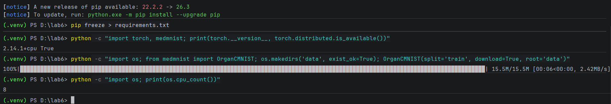<br>
  <em>Рисунок 1 – Встановлення пакетів і завантаження датасету OrganCMNIST</em>
</p>

<p align="center">
  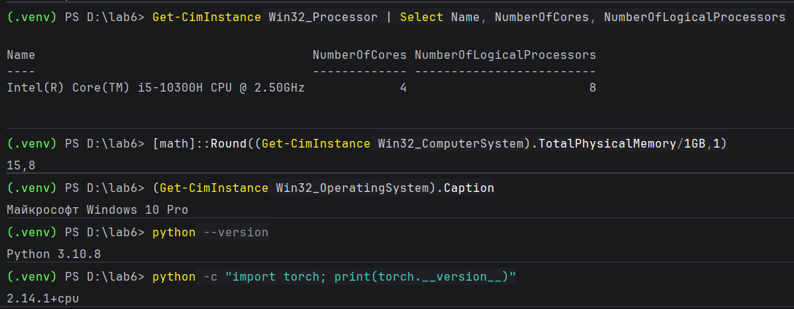<br>
  <em>Рисунок 2 – Параметри машини: процесор, памʼять, ОС, версії Python і PyTorch</em>
</p>

**Таблиця 1. Стенд**

| Процесор                      | Фізичних ядер C_phys | Логічних ядер | Памʼять, ГБ | ОС             | Python | PyTorch    | n_th |
|-------------------------------|----------------------|---------------|-------------|----------------|--------|------------|------|
| Intel Core i5-10300H, 2,5 ГГц | 4                    | 8             | 15,8        | Windows 10 Pro | 3.10.8 | 2.14.1+cpu | 1    |

<p align="center">
  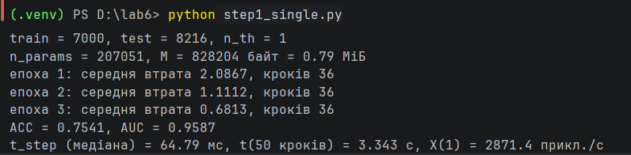<br>
  <em>Рисунок 3 – Навчання в одному процесі (step1_single.py): n_params, M, втрата по епохах, ACC, AUC, t_step і X(1)</em>
</p>

**Параметри датасету і мережі**

| Датасет | K   | C   | c1 / c2 / h   | n_params | M, МіБ | N    | B   | P_max |
|---------|-----|-----|---------------|----------|--------|------|-----|-------|
| Д4      | 11  | 1   | 16 / 32 / 128 | 207 051  | 0,79   | 7000 | 192 | 3     |

Кількість параметрів моделі становить 207 051, а обсяг пам’яті для їх зберігання — приблизно 0,79 МіБ. Скрипт step1_single.py перевіряє правильність розрахунку, помилок не виявлено.

Модель навчалася протягом 3 епох в одному процесі без torch.distributed, з розміром батча 192 та швидкістю навчання 0,02. Загалом виконано 108 кроків навчання. Середня втрата зменшилася з 2,0867 до 0,6813. На тестових даних отримано ACC = 0,7541 та AUC = 0,9587 (рисунок 3).

Швидкість роботи вимірювали окремо: спочатку виконали 10 кроків для прогріву, потім 50 вимірювань. Медіанний час одного кроку становив 64,79 мс, а загальний час 50 кроків — 3,343 с. Продуктивність моделі склала 2871,4 прикладу за секунду. Отримані результати внесено до першого рядка таблиці 2.

### Крок 2

Розроблено скрипт step2_dist.py для навчання моделі з використанням кількох процесів. Кожен процес створює однакову модель, після чого отримує її ваги від процесу 0. Дані розподіляються між процесами та перемішуються перед кожною епохою. Розмір батча становить 64, неповні батчі відкидаються.

Після обчислення градієнтів виконується їх синхронізація між процесами за допомогою dist.all_reduce, а отримана сума ділиться на кількість процесів.

Скрипт підтримує п’ять режимів роботи: equiv для перевірки результатів, manual для ручної синхронізації та вимірювання часу, ddp для навчання з DDP, ddp_ns для перевірки роботи DDP з no_sync та train для повноцінного навчання з DDP. У режимі train втрати записуються у файл results/loss_ddp.csv, а також обчислюються показники ACC і AUC.

У версії PyTorch для Windows немає підтримки libuv, через що стандартний запуск torchrun завершувався помилкою. Змінна USE_LIBUV=0 та параметр --rdzv-conf проблему не вирішили. Тому створено скрипт run_torchrun.py, який вимикає libuv під час запуску, а в step2_dist.py для цього використовується use_libuv=False. Логіка навчання та синхронізації не змінювалася. Приклад запуску:

```bash
python run_torchrun.py --standalone --nproc_per_node=3 step2_dist.py --mode ddp
```

Перевірка еквівалентності (режим equiv). Градієнт g обчислено в одному процесі на перших B = 192 прикладах навчальної частини; ḡ — після ручного all-reduce, де кожен із трьох процесів брав приклади r, r + 3, r + 6, … того самого батча. Після 50 кроків кожен процес рахує суму всіх ваг у float64, суми збираються через all_gather.

<p align="center">
  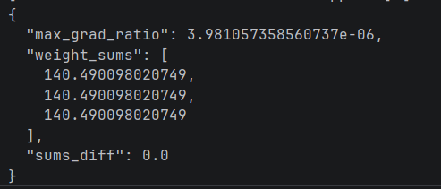<br>
  <em>Рисунок 4 – Результат перевірки еквівалентності (equiv)</em>
</p>

Ручна синхронізація градієнтів (режим manual): t_step і час синхронізації t_sync від першого виклику all-reduce до повернення з останнього.

<p align="center">
  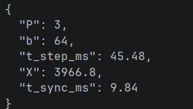<br>
  <em>Рисунок 5 – Ручна синхронізація: t_step = 45,48 мс, t_sync = 9,84 мс</em>
</p>

DDP з типовим розміром кошика (режим ddp).

<p align="center">
  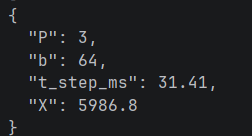<br>
  <em>Рисунок 6 – DDP: t_step = 31,41 мс</em>
</p>

DDP, backward у контексті no_sync (режим ddp_ns): all-reduce не запускається, вимірюється t_step,ns.

<p align="center">
  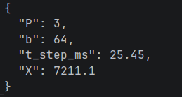<br>
  <em>Рисунок 7 – DDP з no_sync: t_step,ns = 25,45 мс</em>
</p>

Навчання n_ep = 3 епохи з DDP на 3 процесах зі швидкістю навчання η0 (режим train): 108 кроків, ACC і AUC на тестовій частині.

<p align="center">
  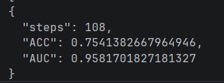<br>
  <em>Рисунок 8 – Навчання з DDP на 3 процесах: 108 кроків, ACC = 0,7541, AUC = 0,9582</em>
</p>

Зведення результатів скриптом step2_table.py.

<p align="center">
  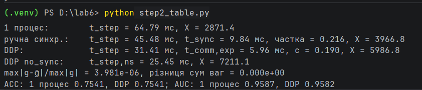<br>
  <em>Рисунок 9 – Зведені результати кроку 2 (step2_table.py)</em>
</p>

**Таблиця 2. Синхронізація градієнтів**

| Режим                               | t_step, мс | Час обміну на крок, мс | Частка кроку в обміні | X, прикл./с |
|-------------------------------------|------------|------------------------|-----------------------|-------------|
| 1 процес, батч B                    | 64,79      | 0                      | 0                     | 2871,4      |
| P_max процесів, ручна синхронізація | 45,48      | 9,84                   | 0,216                 | 3966,8      |
| P_max процесів, DDP                 | 31,41      | 5,96                   | 0,190                 | 5986,8      |
| P_max процесів, DDP, no_sync        | 25,45      | 0                      | 0                     | 7211,1      |

Час обміну даними на один крок для ручної синхронізації становить 9,84 мс, а для DDP — 5,96 мс. Обмін займає 21,6% часу кроку при ручній синхронізації та 19% при використанні DDP.

| max │g − ḡ│ / max │g│ | Різниця сум ваг між процесами після 50 кроків | ACC, 1 процес | ACC, DDP на P_max | AUC, 1 процес | AUC, DDP на P_max |
|-----------------------|-----------------------------------------------|---------------|-------------------|---------------|-------------------|
| 3,98·10<sup>−6</sup>             | 0,0                                           | 0,7541        | 0,7541            | 0,9587        | 0,9582            |

**Еквівалентність.** Найбільше відношення max\|g − ḡ\| / max\|g\| дорівнює 3,98·10<sup>−6</sup>, тобто лежить у межах очікуваних 10<sup>−6</sup>–10<sup>−5</sup>: різниця зумовлена лише порядком додавання в float32. Після 50 кроків суми ваг у float64 однакові в усіх трьох процесах (різниця 0,0): репліки не розходяться, а ваги між процесами пересилати не потрібно. ACC навчання DDP на 3 процесах (0,7541) збігається з ACC одного процесу на батчі B, AUC відрізняється в четвертому знаку (0,9582 проти 0,9587) з тієї самої причини.

**Ручна синхронізація і DDP.** DDP виконує один крок за 31,41 мс, тоді як ручна синхронізація — за 45,48 мс. Отже, DDP працює у 1,45 раза швидше. Продуктивність зростає з 3966,8 до 5986,8 прикладу за секунду. Час обміну даними становить 9,84 мс (21,6% кроку) для ручної синхронізації та 5,96 мс (19%) для DDP. DDP зменшує цей час завдяки об'єднанню восьми окремих операцій обміну в одну. Оскільки розмір градієнтів (0,79 МіБ) менший за розмір кошика DDP (1 МіБ), перекриття обміну з обчисленнями, ймовірно, не відбувається. Для більших моделей таке перекриття може бути помітнішим.

**Розкид між запусками.** Для кожної конфігурації виконано один прогін із 50 вимірюваними кроками. Час роботи може відрізнятися на кілька відсотків залежно від запуску. Наприклад, для DDP на трьох процесах він становив 31,41 мс в одному прогоні та 34,28 мс в іншому. Тому різницю менше ніж 10% не варто вважати суттєвою. Для кроків 3–4 використано результати одного прогону.

### Крок 3

Глобальний батч B = 192 фіксований, батч процесу b = B / P дорівнює 192, 96 і 64 для P = 1, 2, 3 (рядок P = 4 не заповнюється, бо P_max = 3). Прогін з P = 1 також виконано через torchrun з DDP. Для кожного P зроблено два прогони: ddp (t_step) і ddp_ns (t_step,ns); кожен — 10 кроків прогріву і 50 вимірюваних, t_step є медіаною, X = 50 · B / t. Метрики: S(P) = X(P) / X(1), E(P) = S(P) / P, e(P) = (1/S − 1/P) / (1 − 1/P), c = (t_step − t_step,ns) / t_step. Розрахунок і графік виконує скрипт step3_table.py.

<p align="center">
  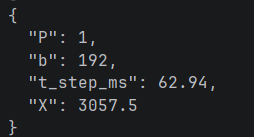
  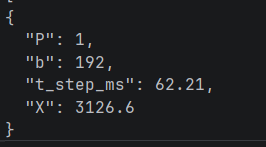<br>
  <em>Рисунок 10 – P = 1 (b = 192): режими ddp (ліворуч) і ddp_ns (праворуч)</em>
</p>

<p align="center">
  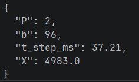
  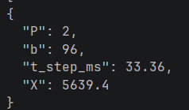<br>
  <em>Рисунок 11 – P = 2 (b = 96): режими ddp (ліворуч) і ddp_ns (праворуч)</em>
</p>

<p align="center">
  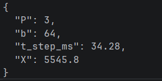
  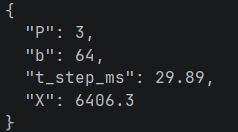<br>
  <em>Рисунок 12 – P = 3 (b = 64): режими ddp (ліворуч) і ddp_ns (праворуч)</em>
</p>

<p align="center">
  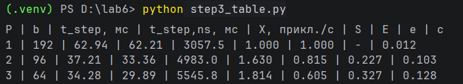<br>
  <em>Рисунок 13 – Таблиця strong scaling (step3_table.py)</em>
</p>

<p align="center">
  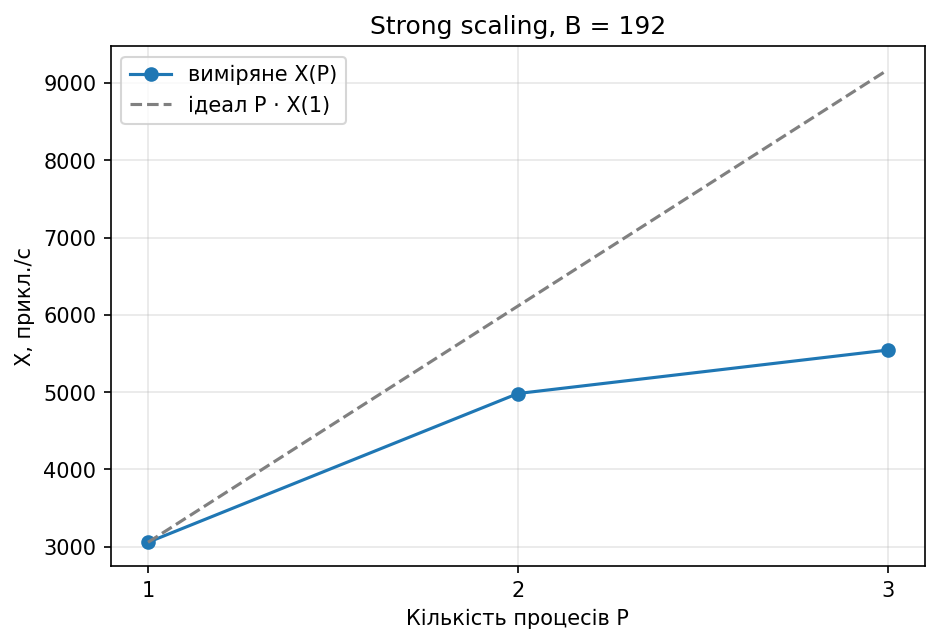<br>
  <em>Рисунок 14 – Strong scaling: виміряна пропускна здатність X(P) і ідеальна пряма P · X(1)</em>
</p>

**Таблиця 3. Strong scaling, B = const**

| P   | b   | t_step, мс | t_step,ns, мс | X, прикл./с | S     | E     | e     | c     |
|-----|-----|------------|---------------|-------------|-------|-------|-------|-------|
| 1   | 192 | 62,94      | 62,21         | 3057,5      | 1,000 | 1,000 | −     | 0,012 |
| 2   | 96  | 37,21      | 33,36         | 4983,0      | 1,630 | 0,815 | 0,227 | 0,103 |
| 3   | 64  | 34,28      | 29,89         | 5545,8      | 1,814 | 0,605 | 0,327 | 0,128 |

Пропускна здатність зростає сублінійно (рисунок 14): S = 1,63 при P = 2 і 1,81 при P = 3 за ідеальних 2 і 3, ефективність E падає з 0,82 до 0,61. Перехід від двох до трьох процесів дає лише +11 % (4983,0 → 5545,8 прикл./с).

Метрика Карпа–Флатта зростає з P (0,227 → 0,327). За методикою це означає, що частка роботи, яка не отримала виграшу, збільшується з кількістю процесів, тобто визначається не сталою послідовною частиною програми, а обміном, синхронізацією і спільним використанням ресурсів машини.

Частка не перекритого обміну c помірна (0,10 → 0,13) і не пояснює всієї втрати ефективності: e помітно більша за c. Решта втрат — у самому обчисленні: t_step,ns (крок без обміну) зменшується з 62,2 мс (P = 1) лише до 33,4 мс (P = 2) і 29,9 мс (P = 3), тоді як ідеальне лінійне зменшення дало б 31,1 і 20,7 мс. Імовірні причини: три процеси по одному потоку ділять 4 фізичні ядра з ОС і фоновими програмами, а також кеш і памʼять; зі зменшенням батча до 64 ядро завантажується гірше, а фіксовані накладні витрати кроку (оптимізатор, Python, DataLoader) не зменшуються. Значення c для P = 1 (0,012) — шум вимірювання, бо обміну в одному процесі немає.

### Крок 4

Батч процесу фіксований: b = B / P_max = 64, глобальний батч B_P = P · b дорівнює 64, 128 і 192. Рядок P = 3 узято з таблиці 3 (та сама конфігурація b = 64), для P = 1 і P = 2 виконано прогони ddp з параметром --b 64. S_w = X(P) / X(1), E_w = S_w / P.

<p align="center">
  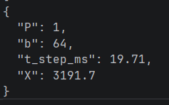
  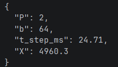<br>
  <em>Рисунок 15 – Вимірювання t_step і X при b = 64: P = 1 (ліворуч) і P = 2 (праворуч)</em>
</p>

<p align="center">
  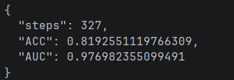
  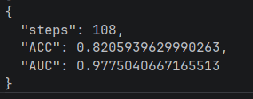<br>
  <em>Рисунок 16 – Навчання n_ep = 3 епохи: P = 1, b = 64, η0 (ліворуч, 327 кроків); P = 3, B = 192, η_P = 0,06 (праворуч, 108 кроків)</em>
</p>

<p align="center">
  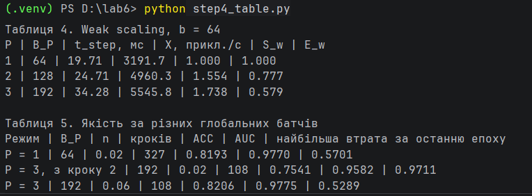<br>
  <em>Рисунок 17 – Таблиці 4 і 5 за даними скрипта step4_table.py</em>
</p>

**Таблиця 4. Weak scaling, b = const**

| P   | B_P | t_step, мс | X, прикл./с | S_w   | E_w   |
|-----|-----|------------|-------------|-------|-------|
| 1   | 64  | 19,71      | 3191,7      | 1,000 | 1,000 |
| 2   | 128 | 24,71      | 4960,3      | 1,554 | 0,777 |
| 3   | 192 | 34,28      | 5545,8      | 1,738 | 0,579 |

За ідеального масштабування час кроку мав би залишатися сталим (19,7 мс), а X — зростати лінійно. Фактично t_step зростає до 24,7 мс при P = 2 і до 34,3 мс при P = 3. Відповідно, S_w становить 1,55 і 1,74, а E_w — 0,78 і 0,58. Причини ті самі, що й у кроці 3: обмін градієнтами та конкуренція процесів за ядра, кеш і пам'ять (три процеси на чотирьох фізичних ядрах). Ефективність weak scaling при P = 3 (0,58) майже збігається з strong scaling (0,61), оскільки конфігурація однакова (b = 64, B = 192), а відрізняються лише базові значення X(1), виміряні окремо для кожної серії.

**Таблиця 5. Якість за різних глобальних батчів**

| Режим                | B_P | η    | Кроків оптимізатора за n_ep епох | ACC    | AUC    | Найбільша втрата за останню епоху |
|----------------------|-----|------|----------------------------------|--------|--------|-----------------------------------|
| P = 1                | 64  | 0,02 | 327                              | 0,8193 | 0,9770 | 0,5701                            |
| P = P_max, з кроку 2 | 192 | 0,02 | 108                              | 0,7541 | 0,9582 | 0,9711                            |
| P = P_max            | 192 | 0,06 | 108                              | 0,8206 | 0,9775 | 0,5289                            |

Кількість кроків: 327 = 3 · ⌊7000 / 64⌋ для P = 1 (b = 64) і 108 = 3 · 36 для трьох процесів (B = 192). Швидкість навчання за лінійним правилом з B<sub>0</sub> = b = 64: η_P = η<sub>0</sub> · B_P / B<sub>0</sub> = 0,02 · 192 / 64 = 0,06.

Зі збільшенням глобального батча втричі кількість оновлень ваг за 3 епохи зменшується втричі (327 → 108). За незмінної η₀ = 0,02 модель недонавчається: ACC знижується з 0,8193 до 0,7541, а AUC — з 0,9770 до 0,9582. Втрата за останню епоху зростає з 0,5701 до 0,9711.

Лінійне масштабування швидкості навчання (ηₚ = 0,06) компенсує зменшення кількості кроків: ACC = 0,8206 і AUC = 0,9775, що майже збігається з результатами P = 1. Різниця становить лише 0,0013 за ACC і 0,0005 за AUC. Навчання залишається стабільним: втрата за останню епоху (0,5289) навіть нижча, ніж при P = 1, попри відсутність розігріву швидкості навчання. Результат отримано для одного зерна, тому висновок обмежується цим набором даних і моделлю.

### Крок 5

Реалізовано скрипт step5_ft.py. Контрольну точку кожні 10 кроків записує лише процес 0. Вона містить стан моделі й оптимізатора, номер епохи, поточний крок та час запису. Спочатку дані зберігаються у ckpt.tmp, потім атомарно переносяться в ckpt.pt через os.replace. Після цього всі процеси синхронізуються через dist.barrier().

Під час перезапуску кожен процес завантажує останню контрольну точку, відновлює модель та оптимізатор, встановлює епоху через sampler.set_epoch(epoch) і пропускає вже оброблені батчі. Це дає змогу продовжити навчання з того самого місця.

Відмову імітує процес із rank = 2: на початку кроку 25 він створює файл fail.marker із часом відмови та завершується через os.\_exit(1) без збереження контрольної точки. Файл-позначка запобігає повторній імітації відмови після перезапуску.

Запуск:

```bash
python run_torchrun.py --standalone --nproc_per_node=3 --max-restarts=1 step5_ft.py
```

**Відхилення від умови.** Умова пропонує статичну адресу групи (--rdzv-backend=static). На цій машині такий запуск не працював: процеси не могли підключитися до сховища за адресою хоста (помилка сокета 10049, запуск зависав), тому використано --standalone з --max-restarts=1; адреса групи 127.0.0.1, а перезапуск усіх процесів після аварійного завершення одного з них виконується так само. Додатково на Windows агент torchrun при перезапуску надсилає дочірнім процесам сигнал CTRL_C_EVENT, який потрапляє в усю консоль і завершував сам агент ще до перезапуску групи; в обгортці run_torchrun.py цей сигнал замінено на звичайне Popen.terminate().

<p align="center">
  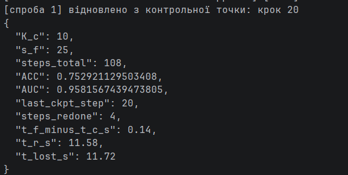<br>
  <em>Рисунок 18 – Відмова процесу rank 2 на кроці 25, перезапуск групи і відновлення з контрольної точки (крок 20); підсумок прогону</em>
</p>

<p align="center">
  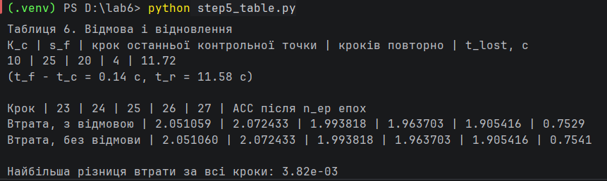<br>
  <em>Рисунок 19 – Таблиці 6 за даними скрипта step5_table.py</em>
</p>

**Таблиця 6. Відмова і відновлення**

| K_c | s_f | Крок останньої контрольної точки | Кроків виконано повторно | t_lost, с |
|-----|-----|----------------------------------|--------------------------|-----------|
| 10  | 25  | 20                               | 4                        | 11,72     |

Відмова сталась на початку кроку 25, остання контрольна точка записана на кроці 20 (K_c = 10), тому повторно виконано 24 − 20 = 4 кроки (21–24); у середньому втрата роботи становить K_c / 2 = 5 кроків. t_lost = (t_f − t_c) + t_r = 0,14 + 11,58 = 11,72 с.

| Крок                       | s_f − 2 (23) | s_f − 1 (24) | s_f (25) | s_f + 1 (26) | s_f + 2 (27) | ACC після n_ep епох |
|----------------------------|--------------|--------------|----------|--------------|--------------|---------------------|
| Втрата, прогін з відмовою  | 2,051059     | 2,072433     | 1,993818 | 1,963703     | 1,905416     | 0,7529              |
| Втрата, прогін без відмови | 2,051060     | 2,072433     | 1,993818 | 1,963703     | 1,905416     | 0,7541              |

Складова t_f − t_c = 0,14 с відповідає чотирьом повторним крокам (≈ 35 мс кожен): роботи, втраченої між останньою контрольною точкою і відмовою, мало. Домінує t_r = 11,58 с — зупинка групи, повторний старт трьох процесів, імпорт PyTorch, читання датасету, створення групи gloo і читання контрольної точки. Цей час не залежить від K_c, тому за таких параметрів (крок десятки мілісекунд, модель 0,79 МіБ) вибір K_c майже не впливає на t_lost, а втрати визначає швидкість перезапуску.

Втрата на кроках 23–27 у прогоні з відмовою збігається з прогоном без відмови до шостого знака: відновлені ваги, стан оптимізатора і порядок прикладів були правильними. ACC після n_ep епох становить 0,7529 проти 0,7541 (різниця 0,0012, приблизно 10 із 8216 тестових прикладів). Найбільша різниця втрати за всі кроки дорівнює 3,8·10<sup>−3</sup>: траєкторії з часом трохи розходяться. Ймовірна причина — float32: порядок додавання в all-reduce і повторний запуск процесів дають мікроскопічні різниці, які стохастичний градієнтний спуск накопичує; такий самий порядок похибки (4·10<sup>−6</sup>) показала перевірка еквівалентності в кроці 2. Окремо цю причину не перевіряли.

## Висновки

1. Паралельне навчання DDP реалізовано правильно: градієнти трьох процесів майже збігаються з результатом одного процесу, а ваги моделей після 50 кроків однакові.

2. DDP працює швидше за ручну синхронізацію: час кроку становить 31,41 мс проти 45,48 мс. Виграш, імовірно, пов'язаний з ефективнішим обміном градієнтами.

3. При збільшенні кількості процесів продуктивність зростає не лінійно через обмін даними, синхронізацію та конкуренцію за ресурси процесора.

4. При weak scaling ефективність становить 0,78 для двох процесів і 0,58 для трьох. Час кроку збільшується з 19,7 до 34,3 мс.

5. Збільшення батча втричі без зміни швидкості навчання погіршує якість моделі. Лінійне збільшення швидкості навчання до 0,06 дозволяє зберегти результати майже на рівні одного процесу.

6. Відновлення навчання після відмови процесу працює: група перезапускається, а навчання продовжується з останньої контрольної точки. Втрата часу становила 11,72 с, переважно через перезапуск.

Усі вимірювання виконано по одному разу на ноутбуці з чотирма фізичними ядрами, тому невеликі відмінності можуть бути пов'язані з похибкою вимірювань. На GPU обчислення швидші, тому відносний вплив обміну даними може бути більшим.
